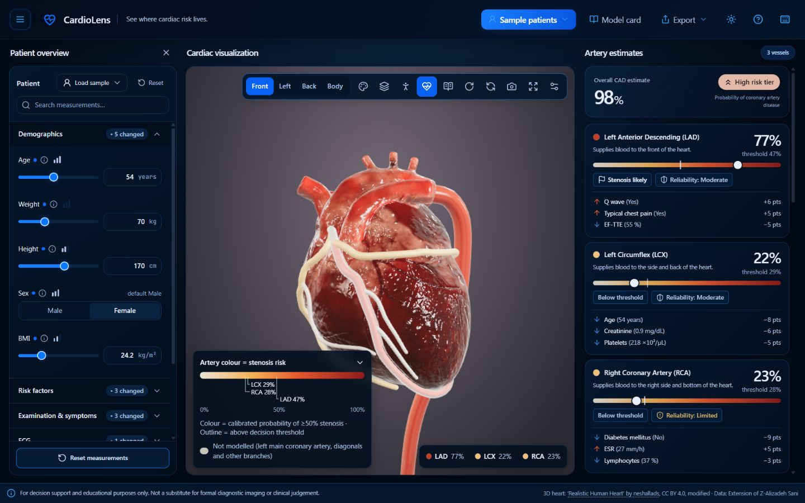
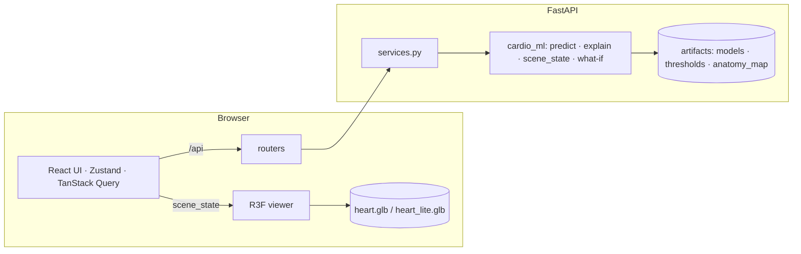

# CardioLens: see where cardiac risk lives

Multimodal AI Hackathon 2026 · Track A · Cardiovascular Risk Visualization & Prediction.

Enter routine clinical data and see **calibrated CAD and per-artery (LAD / LCX / RCA) stenosis risk on an
interactive 3D heart**, with the reasons why and what-if exploration. Decision support and education only.

**Live website:** [havoc · CardioLens](https://havoc-rho.vercel.app/) ·
[Open the LAD sample](https://havoc-rho.vercel.app/?case=lad)



The current interface includes dark and light themes, a smoothly expanding patient sidebar,
a resizable cardiac viewer, and a two-second opening animation that plays once per browser-tab session.
The patient sidebar starts open on desktop (960 px and wider) and closed on smaller screens.
The heart model and trained prediction models remain unchanged.

**Dataset:** Alizadehsani R., Roshanzamir M., Sani Z. *Extension of Z-Alizadeh Sani*. UCI ML Repository, id 411.
<https://archive.ics.uci.edu/dataset/411/extention+of+z> (DOI 10.24432/C5Q31M).

## Run the app
**Easiest (Windows):** double-click **`Start CardioLens.bat`** in the project folder. It runs on its own, with no
Claude or terminal needed. It builds the app if needed, restarts the server if it ever crashes, and opens
<http://localhost:8000>. A shortcut in the Windows Startup folder can start it at every login: delete
`%APPDATA%\Microsoft\Windows\Start Menu\Programs\Startup\CardioLens.lnk` to turn that off.

**In the Claude desktop app (no terminal knowledge needed):** open this folder in Claude and ask:

> run python scripts/dev.py

Claude starts the server and the web app and your browser opens at <http://localhost:5173>. Click
**Sample patients** and pick one. To stop, ask Claude to stop it (or press Ctrl+C in the terminal).

**Requirements (one-time):** Python 3.11 with the project venv (`pip install -r requirements.txt` and
`pip install -e .`) and Node.js 20+. `scripts/dev.py` installs the web packages on first run.

| Command | What it does |
|---|---|
| `python scripts/dev.py` | development: FastAPI on :8000 + Vite on :5173, opens the browser |
| `python scripts/build.py` then `python -m app.backend.main` | production: one server at <http://localhost:8000> |
| `docker build -t cardiolens . && docker run -p 8000:8000 cardiolens` | the same, in a container (for judges) |
| `python scripts/feature_response_audit.py` | how much each input can move each estimate → `artifacts/feature_response.json` + heatmap |
| `python scripts/check_no_hardcoding.py` | fails if the frontend duplicates data owned by the API / artifacts |

Screenshots: [desktop dark](artifacts/figures/app_desktop_dark.png) ·
[desktop light](artifacts/figures/app_desktop_light.png) · [tablet](artifacts/figures/app_tablet_dark.png) ·
[mobile](artifacts/figures/app_mobile_dark.png) · [body mode](artifacts/figures/app_body_mode.png) ·
[territories](artifacts/figures/app_territories.png) · [what-if](artifacts/figures/app_whatif.png) ·
[model card](artifacts/figures/app_modelcard.png) · [PDF report](artifacts/figures/app_report.pdf)

## Deployment

**Production:** [https://havoc-rho.vercel.app/](https://havoc-rho.vercel.app/)

**Project / service name:** `havoc`.

The React frontend and FastAPI prediction API run together in one Vercel container service.
`vercel.json` routes all requests to `havoc`, including the website at `/` and API endpoints at `/api/*`.
`Dockerfile.vercel` builds the frontend with Node.js 22, then serves it with the API on Python 3.12
and port 80. `requirements-runtime.txt` installs inference dependencies; the existing trained artifacts
and heart assets are copied into the image. Deployment does not retrain models or rebuild the heart.

### Deploy from GitHub

1. Sign in to [Vercel](https://vercel.com/new) and install its GitHub integration for this repository.
   The repository owner may need to grant access: collaborator write access alone did not allow linking
   the current deployment.
2. Import `SoAkeD1/cardio-risk-heart-3d`, select the desired Vercel team, and name the project `havoc`.
3. Keep **Root Directory** at `./` and use the **Services** preset. Vercel reads the committed
   `vercel.json` and `Dockerfile.vercel`; do not select `app/frontend` as the root for the full application.
4. Deploy, then open the production domain shown by Vercel. The current production domain is
   `havoc-rho.vercel.app`; another account may receive a different available domain.

After the GitHub integration is connected, pushes to the configured production branch can deploy
automatically. The current `havoc` deployment was published through the CLI; automatic GitHub
deployment still requires the repository-owner integration setup.

### Deploy with the Vercel CLI

Run these commands from the repository root with Node.js installed. The CLI version below was used
for the verified deployment. Replace `YOUR_TEAM_SLUG` with your Vercel team slug; the current deployment
belongs to `inferno11` (team name **Inferno**), while its project and service are named **havoc**.

```bash
npx vercel@63.1.2 login
npx vercel@63.1.2 link --yes --scope YOUR_TEAM_SLUG --project havoc
npx vercel@63.1.2 project inspect --non-interactive --scope YOUR_TEAM_SLUG
npx vercel@63.1.2 deploy --prod --skip-domain --scope YOUR_TEAM_SLUG --project havoc
```

Confirm that `project inspect` reports the intended team and `havoc` project. CLI deployment uploads
the local checkout, so commit the intended changes first. `.vercelignore` excludes local credentials,
virtual environments, logs, and scratch files. No separate frontend API URL is required.

Use the deployment URL printed by the CLI to check the staged build before promotion:

```bash
npx vercel@63.1.2 curl /api/health --deployment DEPLOYMENT_URL --scope YOUR_TEAM_SLUG
npx vercel@63.1.2 promote DEPLOYMENT_URL --scope YOUR_TEAM_SLUG
```

Complete verification by opening the site, loading a sample patient, checking the 3D heart and artery
estimates, and switching themes. The first request after an idle period may take longer while the
container loads the trained models. For protected staged URLs, `vercel curl` provides authenticated
access without disabling deployment protection.

Vercel builds the container remotely, so Docker is not needed for this CLI deployment. To test the
same image locally with Docker installed:

```bash
docker build -f Dockerfile.vercel -t havoc .
docker run --rm -p 8000:80 havoc
```

Then open [http://localhost:8000](http://localhost:8000). Platform references:
[Vercel Container Runtime](https://vercel.com/docs/functions/runtimes/container) and
[Vercel Services](https://vercel.com/docs/services).

## Problem statement → where it is met
| PS ref | Requirement | Where it's met |
|---|---|---|
| 1a–e | Models, leakage rule, metrics | Steps 1–4 (`cardio_ml/`, `artifacts/metrics.json`); surfaced in the **Model card** (hold-out metrics with 95% CIs, nested CV, calibration); the API rejects label columns (400) |
| 2a | Interactive 3D torso/heart (R3F) | `app/frontend/src/three/` (React Three Fiber viewer, heart + body mode) |
| 2b | LAD/LCX/RCA colours update from probabilities | `useSceneBinding.ts` copies `scene_state` colours (e2e: equal to the API ±1/255) |
| 2c | Rotate / zoom / select → vessel risk detail | OrbitControls, picking + tooltips, fly-to anchors, vessel cards (two-way selection) |
| 3a | CAD status + vessel probabilities beside the canvas | Right panel: risk summary + vessel cards |
| 3b | Interpretable breakdown (SHAP) | "Why?" section: SHAP waterfall for CAD / LAD / LCX / RCA |
| 3c | Measurements + relative contribution | Physiological breakdown (6 groups) + sortable measurement table with typical ranges |
| 4a | Open-source meshes | Sketchfab "Realistic Human Heart" (CC BY 4.0), credited in the UI, model card, PDF and GLB |
| 5 | Visible disclaimer | Persistent, non-dismissible strip; every PDF page; model card |
| Tech | No dedicated GPU needed | lite model (auto on low-memory/touch), performance mode, demand frame loop |
| Tech | Extensible | schema-driven UI, `anatomy_map`-driven 3D, model registry in `cardio_ml` |
| Tech | Consistent correspondence | mesh names / colours only from `scene_state` + `anatomy_map` |

## Architecture

See [`docs/ARCHITECTURE.md`](docs/ARCHITECTURE.md), the demo plan in [`docs/DEMO_SCRIPT.md`](docs/DEMO_SCRIPT.md)
and every non-obvious choice in [`docs/DECISIONS.md`](docs/DECISIONS.md).

## ML pipeline (Steps 1–4)
The pipeline predicts **overall CAD** (`Cath`) and **stenosis of the LAD, LCX and RCA** from routine clinical
data, with calibrated probabilities and SHAP/LIME explanations in clinical-feature language.

## Layout
```
cardio_ml/            importable package (all transformers / classes live here)
  config.py           paths, seeds, FAST_MODE, targets, feature metadata + groups, risk-tier rule, DISCLAIMER
  data.py             loading, column normalisation (UCI/Kaggle), deterministic encoding, feature schema
  features.py         sklearn transformers: encoder, clinical feature engineering, log/scale, selectors
  models.py           model registry (name -> builder + Optuna space), pipeline/ensemble factories
  evaluation.py       splits, nested CV, fixed-config CV, metrics, bootstrap CIs, caching
  vessels.py          vessel strategies: classifier-chain ensemble, hierarchical P(CAD)·P(vessel|CAD)
  explain.py          SHAP (Tree/Linear/Permutation/surrogate), raw-feature + group mapping, LIME
  plots.py            figure helpers (150 dpi), incl. 2D coronary schematic preview
  predict.py          predict_patient(), explain_patient(), benchmark()
  anatomy.py          Step 5: scene_state(), what_if(), sensitivity_curve(), validate_glb_names()
tests/
  test_anatomy.py     pytest suite for the mapping layer (+ snapshots/)
notebooks/
  track_a_ml.ipynb    the executed notebook (saved with outputs)
  track_a_ml.py       the same notebook as a py-percent script (diff-friendly source)
artifacts/            exported models, JSONs, figures, ML_SUMMARY.md
data/                 put the UCI .xlsx here (or set CARDIO_DATA_PATH)
```

## Run
```bash
py -3.11 -m venv .venv
.venv\Scripts\python -m pip install torch==2.14.1 --index-url https://download.pytorch.org/whl/cpu
.venv\Scripts\python -m pip install -r requirements.txt
.venv\Scripts\python -m pip install -e .
# data: download the UCI zip and extract "extention of Z-Alizadeh sani dataset.xlsx" into ./data
.venv\Scripts\jupyter nbconvert --to notebook --execute --inplace --ExecutePreprocessor.timeout=-1 notebooks/track_a_ml.ipynb
```
* `CARDIO_FAST_MODE=1` gives a quick run (2 CV repeats, 8 Optuna trials). The default is the full run
  (5×5 CV, 30 trials per fold, 50 for the final tuning).
* `CARDIO_DATA_PATH` points to the dataset (.xlsx or .csv, UCI or Kaggle column names).
* Expensive CV results are cached in `artifacts/cache/`, keyed by the run configuration. Delete that folder to
  recompute from scratch.
* TabPFN v2 is attempted. Its weights are licence-gated on HuggingFace, so it is **skipped and logged** unless
  `TABPFN_TOKEN` is set. The pipeline never opens a browser.

## Use the trained models
```python
from cardio_ml.predict import predict_patient, explain_patient
r = predict_patient({"Age": 63, "Sex": "Male", "Typical Chest Pain": 1, "DM": 1, "EF-TTE": 45, "Region RWMA": 2})
r["cad"]        # {"prob", "label", "threshold", "risk_tier"}
r["lad"], r["lcx"], r["rca"], r["expected_stenotic_vessels"]
r["explanations"]["lad"][0]   # {feature, label, group, value, unit, shap, contribution_pct, direction}
r["group_contributions"]["cad"]
```
* Feature names may be the clean names (`ef_tte`) or the original ones (`EF-TTE`).
* Missing inputs fall back to the defaults in `feature_schema.json`. Unknown names, label columns
  (Cath/LAD/LCX/RCA), non-numeric values, values outside physiological limits and invalid categories raise
  `ValueError`.
* `shap` is in **probability units**: per patient, the contributions sum to P(patient) − mean P(background).
  `contribution_pct` = |shap| / Σ|shap| × 100.
* The keys `lad`, `lcx` and `rca` are fixed and match the 3D mesh names.
* Region RWMA is an echo feature only. It is not an anatomical coordinate and must never be mapped onto the
  3D model.

## Step 5: prediction → anatomy mapping (`cardio_ml/anatomy.py`)
```python
from cardio_ml.predict import predict_patient
from cardio_ml import anatomy as A

pred  = predict_patient(patient, k=55)                 # k=55: complete regional totals
scene = A.scene_state(pred, target_focus="lad", show_territories=False)
scene["meshes"]["Coronary_LAD"]   # {color, emissive, opacity, pulse_hz, flagged, outline_color, badge, ...}
scene["vessels"]["rca"]           # {prob, threshold, flagged, reliability, top_drivers, tooltip, camera_anchor}
scene["regions"]                  # top-3 torso regions: intensity, raises/lowers, arrow icon, tooltip

w = A.what_if(patient, {"ldl": 90, "bp": 120, "current_smoker": 0})   # model-estimated change, NOT causal
w["delta_per_target"], w["scene_before"], w["scene_after"]
A.sensitivity_curve(patient, "fbs")                    # [{value, cad, lad, lcx, rca}, ...] over the training range
A.validate_glb_names("heart.glb")                      # Step 6 asset gate -> {"ok": True, ...}
```
* **Single source of truth:** [`artifacts/anatomy_map.json`](artifacts/anatomy_map.json) holds vessels, territories,
  neutral structures, the body-region map (all 55 features), modifiable features and every visual constant.
  Mesh names, texts and colours are never hard-coded (this is tested).
* **Colour vs. flag:** colour is the calibrated probability on one shared CIELAB scale (lightness strictly
  monotonic). A flag (badge, outline and pulse) means prob ≥ that vessel's threshold. Each vessel also has a
  reliability badge derived from its hold-out AUC.
* **Contracts:** `scene_state.schema.json` describes the scene state. `ASSET_SPEC.md` is generated from the map
  and specifies meshes, anchors and the budget for the Step 6 `.glb`. `STEP5_MAPPING.md` is the one-page rationale.
* **Tests:** `python -m pytest tests -q` runs 15 tests. These cover the map, the colour scale, flags, the schema,
  snapshots, what-if, latency, the disclaimer, the glb validator and the no-hard-coding check. If a change to
  the scene state is intended, refresh the snapshots with `UPDATE_SNAPSHOTS=1`.

## Rebuild the 3D asset (Step 6 / 6B)
Requirements:
* Blender 5.x (tested on 5.2.2 LTS).
* Node 18 or newer, then `npm install` once. This installs `@gltf-transform/cli`, which does the Draco and WebP
  compression.
* The source model in `assets_src/sketchfab_heart/`, and the HDRI in `assets_src/hdri/`.

```bash
.venv\Scripts\python blender/make_all.py
```
This builds `artifacts/heart.glb`, `artifacts/heart_lite.glb`, `blender/heart_source.blend` and
`artifacts/viewer_look.json`. It renders both looks (`artifacts/figures/heart_*.png`, `*_clinical.png`,
`territories_demo*.png`, `body_front*.png`, `lite_vs_full.png`, `compare_sketchfab_vs_ours.png`, `src_*.png`). It
then re-imports and checks both files (`blender/check_glb.py`) and runs `validate_glb_names()`.

If Blender is installed elsewhere, add `--blender <path>`. Add `--heart-source procedural` to rebuild the earlier
fully procedural CC0 heart; the Step 6 originals are also kept in `backup/step6_procedural/`.

To run the web smoke test:
```bash
.venv\Scripts\python blender/serve_preview.py
```
Then open <http://localhost:8765/blender/preview.html>. Add `?save=1` to write `artifacts/figures/web_preview.png`.

The page includes:
* the three.js settings from `viewer_look.json`
* a Realistic ↔ Clinical toggle, via `KHR_materials_variants`
* nearest-hit picking over the hit proxies and the myocardium
* the LAD outline and glow demo
* Heart/Body and territory toggles
* an FPS counter

See [`artifacts/STEP6_ASSET.md`](artifacts/STEP6_ASSET.md) for the asset notes.

## Credits
* **Heart model:** This work is based on "Realistic Human Heart" (https://sketchfab.com/3d-models/realistic-human-heart-3f8072336ce94d18b3d0d055a1ece089) by neshallads (https://sketchfab.com/neshallads) licensed under CC-BY-4.0 (http://creativecommons.org/licenses/by/4.0/)
  *Modifications:* re-aligned, re-scaled, split into parts, coronary tubes and territories added, clinical
  texture variant added. The same text is embedded in both GLBs (`asset.extras.attribution`) and in
  `anatomy_map.json → asset.sources`.
* **Lighting:** "Studio Small 09" HDRI by Poly Haven (https://polyhaven.com/a/studio_small_09), CC0. It is used for
  lighting only and is not shipped inside the GLBs.
* **Coronary tubes, territories, body and organs:** original procedural geometry, CC0.
* **Data:** Z-Alizadeh Sani extension (UCI ML Repository, id 411), CC BY 4.0.
* **Libraries:**
  * App: React, React Three Fiber, drei, three.js, Zustand, TanStack Query, Radix UI, lucide-react, jsPDF,
    Tailwind CSS (all MIT), Inter and JetBrains Mono fonts (SIL OFL 1.1), FastAPI, Uvicorn, Pydantic (MIT/BSD).
  * ML: scikit-learn (BSD-3), XGBoost / LightGBM / CatBoost (Apache-2.0 / MIT), SHAP (MIT), LIME (BSD-2).
  * `glTF-Transform` (MIT) and the Draco encoder (Apache-2.0), used only at build time.

## Artifacts
| file | content |
|---|---|
| `models/{cad,lad,lcx,rca}.joblib` | full fitted pipelines (encoding → features → selection → model → calibration; vessel files embed the CAD model when the hierarchical strategy is used) |
| `feature_schema.json` | every raw input: name, original name, group, type, allowed values / range, default, unit, label |
| `thresholds.json` | F1-optimal thresholds per target (+ CAD Youden and high-sensitivity), risk-tier cut-offs and rule |
| `metrics.json` | nested-CV results for every model × target, strategy and calibration comparisons, hold-out metrics with 95% CIs, latency |
| `ablation.json` | raw → +engineered → +selection → +ensemble → +vessel strategy |
| `split.json` | hold-out indices (seed 42) |
| `shap_background.joblib` | 50 k-means-medoid training patients (SHAP background) + training rows for surrogates |
| `figures/*.png` | EDA, model zoo, ablation, calibration, hold-out ROC/PR/calibration/confusion, SHAP plots |
| `ML_SUMMARY.md` | 2-page summary for the documentation |
| `anatomy_map.json` | Step 5 mapping config (vessels, territories, body regions, modifiable features, style) |
| `scene_state.schema.json` | JSON Schema of `scene_state()` output |
| `ASSET_SPEC.md` | Step 6 contract (generated): mesh / anchor names, glb budget, licences |
| `STEP5_MAPPING.md` | 1-page mapping rationale for the documentation |
| `figures/coronary_schematic_{low,moderate,high}.png` | 2D scene-state previews |
| `heart.glb`, `heart_lite.glb` | Step 6 web asset (full ≤150k / lite ≤60k triangles, Draco, Y-up, contract names) |
| `asset_build_report.json` | build-time measurements (centreline distances, territory gaps/overlaps, triangles) |
| `STEP6_ASSET.md` | ½-page asset notes for the documentation |

> For decision support and educational purposes only. Not a substitute for formal diagnostic imaging or clinical judgement.
