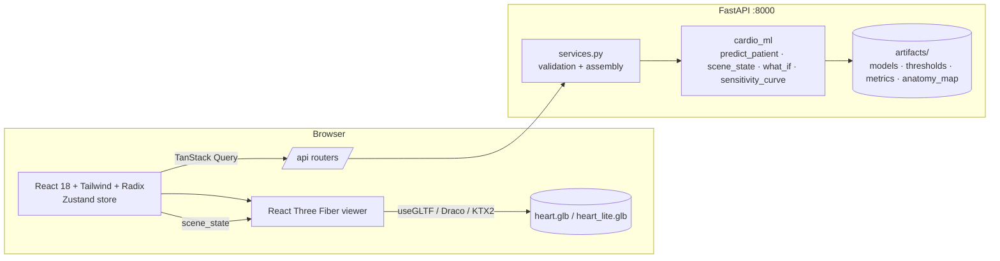

# Step 7 + 8 plan: CardioLens

## Architecture


## Screens
1. Main workspace: patient panel (left), 3D canvas (centre), results (right), disclaimer strip.
2. Model card (dialog), shortcut sheet (dialog), tour (coach marks).
3. Fallbacks: no-WebGL 2D schematic, backend-offline banner.
4. Responsive variants: drawer and bottom sheet (tablet), and tabs (mobile).

## Component tree (abridged)
```
App
├─ TopBar (logo, SampleMenu, ModelCard, Export, Theme, Help, Shortcuts)
├─ StatusBanner
├─ PatientPanel → FieldGroup[] → FieldControl (Toggle | Segmented | Select | Slider+NumberField)
├─ Viewer (Canvas) → Environment · HeartModel(useSceneBinding, variants) · Picking · CameraRig
│                     · Territories · BodyLayer/RegionGlow · Heartbeat · Tooltip3D
│   └─ CanvasToolbar · Legend · WhatIfChip · ProgressOverlay
├─ ResultsPanel → RiskSummary · VesselCards · WhyPanel(ShapWaterfall) · GroupBreakdown + MeasurementTable · WhatIfPanel
└─ DisclaimerStrip (+ footer credits)
```

## API
`GET /api/health · /api/schema · /api/examples · /api/model-card · /api/anatomy-map · /api/viewer-look`;
`POST /api/predict · /api/what-if · /api/sensitivity`. All share one error shape; every prediction-bearing
response carries `disclaimer` + `latency_ms`.

## Risks and mitigations
| Risk | Mitigation |
|---|---|
| SHAP latency (~140 ms) per request; slider storms | 250 ms debounce + AbortController; keep the last result rendered |
| Large GLB on weak GPUs | lite file auto-selected (deviceMemory / coarse pointer); PerformanceMonitor fallback; demand frameloop |
| Colour drift between API and 3D | the frontend only copies scene colours; an e2e test compares material colours with the API (±1/255) |
| CDN dependence | fonts, Draco/Basis decoders and the HDRI are self-hosted in `public/` |
| Misreading what-if as causal | permanent caveat text in the panel and the PDF |
| Third-party design skills | not installed (see DECISIONS.md); design rules from the prompt are applied directly |
